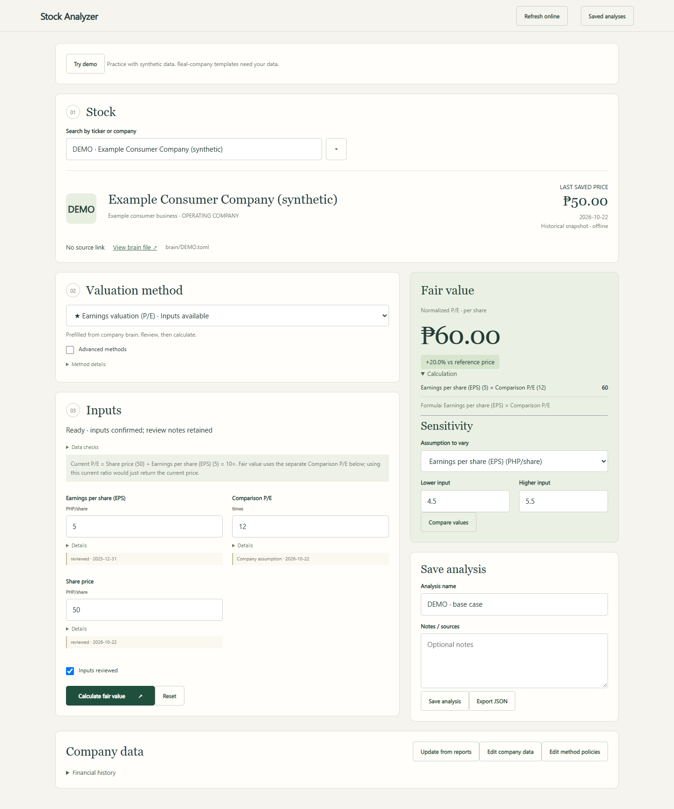

# Fundamental — Offline Valuation Workbench

A personal research tool for valuing Philippine listed companies. Select a business,
choose a valuation method, review sourced inputs, and experiment with assumptions.
Calculations run locally and can be saved with the data and policy used.



## Run locally

Requires Python 3.11 or newer. For report parsing and optional PSE EDGE refresh,
double-click **Setup Report Tools.cmd** once while online (or run
`python -m pip install -r requirements-lock.txt`). After setup, local report parsing and
valuation work offline. No Node installation, API keys, database or AI service is needed.

```sh
python run.py
```

Open http://127.0.0.1:8765 in a browser. On Windows you can also double-click
`Launch Workbench.cmd`; it opens the browser automatically and uses the setup environment. Stop the server with Ctrl+C. Use `python run.py --port 8766`
if the default port is occupied. The server binds only to loopback.

## Workflow

1. Search for a ticker or company name.
2. Choose a recommended method or another supported method. Recommendations reflect
   company type, not a guarantee that all necessary inputs are available.
3. Review the input descriptions, source links, dates, and units. Enter missing
   figures, change assumptions, and confirm the inputs.
4. Calculate fair value. Read the calculation breakdown and limitations.
5. Save a named analysis with a short thesis, or export the analysis as JSON.

Reported data and assumptions are separate. Editing the valuation form does not
overwrite company data. Use **Edit company data** to update a baseline, and **Edit
method policies** to change recommended methods, default assumptions, or field help.
Company data has a structured form; an advanced JSON editor is also available.
Method policies also have form controls, with advanced JSON editing available.
Previous file versions are saved
under `runtime/revisions/`. Conflicting edits are rejected rather than overwritten.

## Local files

| Folder | Purpose |
| --- | --- |
| `backend/` | Deterministic formulas, validation and local HTTP API |
| `frontend/` | Buildless HTML, CSS and JavaScript; no remote assets |
| `brain/` | One editable TOML company brain; longer evidence history in brain/research |
| `policies/catalog.json` | Method descriptions, required inputs, recommendations and defaults |
| `scenarios/` | Saved assumptions, results, company snapshot and policy snapshot |
| `tests/` | Independent calculation and API checks |

In the private workspace, the company dataset comes from previously downloaded local research. It
is historical, not a live feed. Prefilled metrics retain a **needs_review** label;
candidate extracted facts are displayed for research but are not silently promoted
into calculation inputs. Publication dates are not interchangeable with financial
period end dates. Missing cash-flow inputs remain blank.

Prices are last-saved references, with their source dates. **Refresh online** requests
the latest available PSE EDGE price, EPS and book value only when clicked. Review and
apply the proposed changes; a failed request preserves saved data. Quotes may be delayed.

## Update company figures

1. Save downloaded reports in `reports/TICKER/`, for example `reports/URC/`.
2. Select that stock and click **Update from reports**, choose one file, then **Scan folder**.
3. For PDF/text, enter the annual financial period end and the report's unit scale.
   Saved PSE EDGE financial-summary HTML supplies its own dates and per-share units.
4. Check the proposed figures against their source rows, select the correct ones,
   confirm the company/period/units, and apply. The company brain updates locally.

Supported files: text-based PDF, saved HTML and plain text. This is a conservative
extractor, not a universal report reader: scanned PDFs need manual entry; repeated
or unrecognized rows remain missing. PDF extraction proposes the first numeric
column and requires review. Each scan processes only the selected report, with its own period and unit scale. Successfully applied files are tracked by hash to avoid repeat imports.
Original downloads stay private and are excluded from the release archive.

PSE EDGE summary pages provide EPS and book value per share. Full cash-flow statements
and debt notes are generally needed for DCF. The DCF helper shows which statement
figures to use and calculates cash flow and net debt when those inputs are available. A working-capital
helper uses current and previous operating receivables, inventories and payables;
review other operating movements separately. Recognized two-column report rows
can prefill these balances. Missing or ambiguous figures remain manual inputs.

**Current P/E = share price / EPS** describes today's price. **Comparison P/E** is
the benchmark used for fair value: EPS × comparison P/E. Using current P/E would
simply return today's price. Where available, the prefilled benchmark is the median
of a saved same-industry peer sample, with its members disclosed; it is not a live
industry average. Growth, required return and asset discounts are editable modeling
assumptions, with their bases explained in the form; they are not reported company facts.

## Method choices

The main selector has five choices: **DCF, dividends, earnings, book value, and assets**.
Enable **Advanced methods** only when you need a specialist variant. Each company
has its own editable assumptions in `brain/TICKER.toml`; the app reports missing
inputs before calculation and initially selects a prefilled recommended method when available.

Open [the brain folder guide](brain/README.md) to edit a company in Notepad.
The **PSE EDGE** and **View brain file** links appear beside the selected company.

## Implemented methods

- Five-year FCFF DCF at WACC, with an enterprise-to-equity bridge
- Five-year FCFE DCF at cost of equity, without another debt subtraction
- Gordon-growth dividend discount model
- Normalized P/E and relative P/B
- Justified P/B and residual income
- SOTP, NAV and RNAV from reviewed attributable component totals
- P/AFFO, dividend capitalization and property capitalization
- Insurance embedded value from reviewed actuarial inputs

Rates are decimals in files and percentages in the interface. Monetary totals use
actual PHP, not thousands or millions. Per-share values are PHP per common share.
Terminal growth must be below the discount rate and cannot exceed 5%. Definitions
and assumptions are shown in the form. Methods are estimates, not automatic ratings.

After calculating, use **Test an assumption** to compare lower/base/higher inputs.
Every case is recalculated independently. These are sensitivity cases, not assigned
probabilities or automatic bear/bull predictions. Saving an analysis retains all
three results and the varied inputs.

## Development and verification

```sh
python -m unittest discover -s tests -v
node --check frontend/app.js
```

Node is optional and only needed for the JavaScript syntax check. The migration
script under `scripts/` is an optional development utility for the original watcher
workspace. The application does not import or depend on that workspace.

## GitHub preparation

Upload the extracted generated release archive as the repository root. It contains
blank company templates and a synthetic DEMO company; your personal working
directory contains private downloaded research and should not be uploaded. `.gitignore` excludes private scenarios, revision backups,
environment files and generated caches. Review the included research data and
see the included MIT license for original code. Third-party data is excluded from that license. No original report PDFs or live database are
included. GitHub can host the source; local file saving requires running the Python
server and cannot run directly on static GitHub Pages.

## Walkthrough and verification

See the [portfolio walkthrough](docs/WALKTHROUGH.md), [data and assumptions policy](docs/DATA_POLICY.md),
and [GitHub upload guide](docs/GITHUB.md). Replay the documented example with
`python scripts/replay_example.py`.

Automated Edge checks exercise TEL DDM/DCF, beta/WACC, sensitivity saving, export and
reload, persistent source edits, policy edits, bank/REIT recommendations, and mobile
width while blocking external network requests. Optional development setup:

```sh
python -m pip install --target runtime/qa_packages playwright
python scripts/browser_check.py
```

The browser script uses installed Microsoft Edge on Windows. It edits only a temporary
copy of the data. Core tests and the application do not require this tooling.

Create the upload archive with `python scripts/package_project.py` and verify the
extracted standalone app with `python scripts/verify_package.py`. See
[verification details](IMPLEMENTATION_STATUS.md) for scope and limitations.

## Completion and public demo

See [TODO.md](TODO.md) for the checked completion list, [formula references](docs/FORMULAS.md), and [public release rules](docs/PUBLIC_RELEASE.md). In the generated public archive, select **DEMO** to try P/E (PHP 60) and DCF (PHP 48) using entirely invented data. The 61 real-company templates start blank; fill them with your own reviewed figures.
