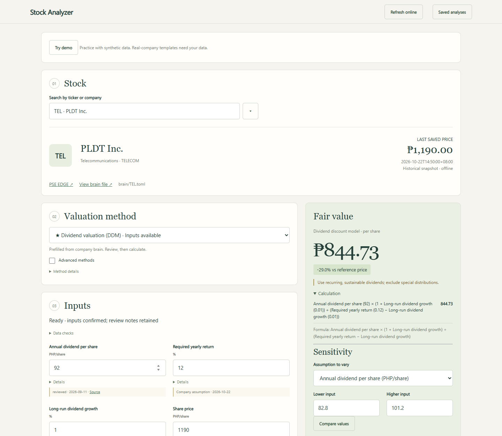
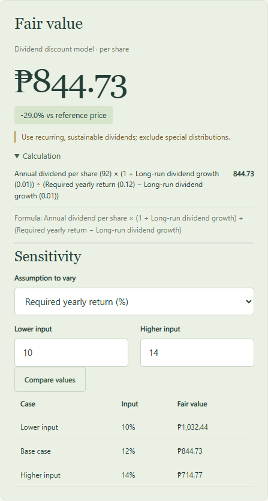
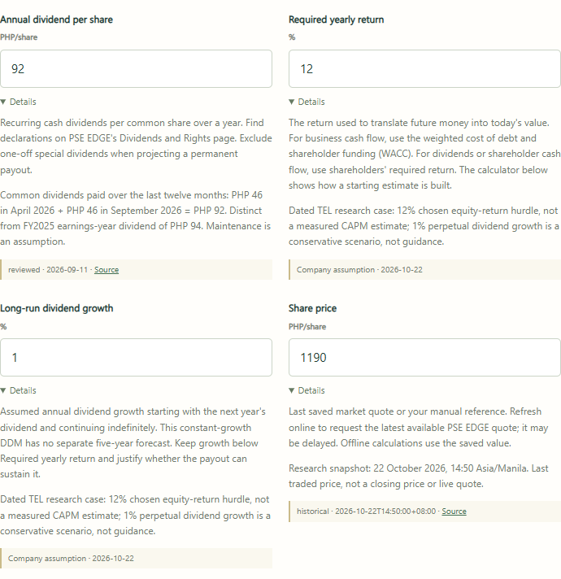

# PSE Valuation

[](https://github.com/cocomonster421/PSE-Valuation/actions/workflows/tests.yml)

**An offline Philippine stock valuation workspace that turns sourced financial
figures and explicit assumptions into explainable fair-value estimates.**

**Problem:** a valuation is difficult to defend when its financial periods, source
figures and assumptions are mixed together or lost between spreadsheet versions.

**Solution:** select a stock and model, inspect the sources, change assumptions,
compare valuations, and save the inputs behind the result. Calculations run locally.

**Project ownership:** [Manco / cocomonster421](https://github.com/cocomonster421).
The project covers valuation-workflow requirements, model selection, a Python
calculation backend, a JavaScript interface, report-import review and regression testing.

[Read the TEL research case](docs/TEL_CASE_STUDY.md) ·
[Inspect the BDO bank-model example](docs/BDO_CASE_STUDY.md) ·
[See test coverage](docs/VERIFICATION.md) ·
[Run locally](#getting-started)

## See it working

Actual application screenshot using the dated TEL case inputs. The price is a saved
22 October 2026 snapshot; the valuation is conditional on the selected assumptions.



| Vary the required return | Inspect financial sources |
| --- | --- |
|  |  |

## One investment question: does TEL's dividend justify its price?

The [TEL case study](docs/TEL_CASE_STUDY.md) distinguishes FY2025's earnings-year
dividend from the latest twelve-month payments, rolls reported EPS forward, and
explains why a dividend model is used rather than an unsupported enterprise DCF.

| Dated reference price | Illustrative dividend scenario | Analytical conclusion |
| --- | --- | --- |
| PHP 1,190, 22 Oct 2026 at 14:50 | PHP 844.73 at a 12% required return and 1% growth | A conditional scenario, not an established TEL price target. Required return and dividend growth still need independent calibration. |

The report includes primary-source links, a 15-cell sensitivity table, risks and
reverse calculations showing what the reference price implies. Its data is frozen
in [a separate case file](examples/tel_case.json). An unresolved annual EPS conflict
is documented; the earnings ratios remain provisional. Real-company working templates
remain blank. No reports are redistributed.

In the app, click **Open TEL research case**, review the dated inputs, then
**Calculate fair value**. This leaves your company data unchanged and includes
the source qualifications in saved analysis notes.

Reproduce the case with Python alone:

```sh
python scripts/replay_tel_case.py
```

## Reliability you can inspect

The test badge links to actual GitHub Actions results. The workflow runs on Linux
and Windows with Python 3.11 and 3.14; it tests formulas, validation and APIs, replays
the TEL case, and starts an extracted release independently.

- **DCF correctness:** a closed-form growing-annuity check, a zero-growth perpetuity,
  share-count scaling and the enterprise-to-equity debt bridge.
- **Dividend correctness:** independently discounted annual payments and agreement
  with FCFE when all shareholder cash is distributed under identical assumptions.
- **Invalid inputs:** missing/non-finite values, zero shares, inconsistent growth and
  discount rates, and invalid comparison inputs are rejected.
- **Edge cases:** FCFE avoids subtracting debt twice; nonpositive modeled equity is
  flagged; source revisions prevent conflicting saves.
- **Reproducibility:** stored inputs reproduce the result; the TEL case's sensitivity
  table is checked automatically. Browser tests separately cover editing, imports,
  saved analyses and mobile layout.

Tests validate calculations and software behavior, not source accuracy or investment
performance. See [verification scope and commands](docs/VERIFICATION.md).

Input confirmation preserves unresolved warnings. Company files can record reporting
issues and dated assumption explanations; results distinguish illustrative scenarios
from documented assumptions. See the [reliability checklist](docs/RELIABILITY_CHECKLIST.md)
for implemented checks and remaining limitations.

Each calculation starts a sensitivity check automatically. The editable starting
range is an illustrative stress, not an industry estimate or confidence interval.
Results flag when changing the selected input moves value across the reference price.

Use **Check all stocks** to review the local company files together. Expand a ticker
to see method-specific missing data, assumption evidence and reporting issues; use
**Open inputs** to address them. **Export checks** saves a dated JSON snapshot. The
scan does not fetch data or change your files, and a calculated value is not a
verified investment target.

Local report scans also show possible disclosure issues with source excerpts. You
can save selected passages for reporting review even when no financial figures are
found. Screening covers only readable selected text/pages, shows at most 20 matches
per file, and cannot determine whether a passage is negated, historical or resolved.
No matches does not mean a clean report. Online price/summary refresh does not run
this disclosure screen.

DCF also includes a [cash-flow reconciliation helper](docs/CASH_FLOW_RECONCILIATION.md)
with separate FCFF/FCFE paths, interest-classification adjustments and saved lease,
ownership and source explanations. The arithmetic is reproducible; accounting
classification and forecast sustainability still require research.

## Getting started

Requires **Python 3.11 or newer**. Download and extract the repository, keeping its
folders intact. On Windows, double-click **Launch Workbench.cmd**. Alternatively:

```sh
python run.py
```

Open http://127.0.0.1:8765 and select **Try demo**. The synthetic example produces
PHP 60 per share using P/E and PHP 48 using DCF. The 61 real-company templates contain
company metadata but start with blank financial figures. They are a saved selection,
not a current index-constituent list.

For PDF/HTML imports and optional PSE EDGE refresh, run **Setup Report Tools.cmd**
once while online. It installs the pinned parser dependencies in `.venv`; the
Windows launcher uses that environment automatically. A command-line alternative is:

```sh
python -m pip install -r requirements-lock.txt
python run.py
```

Calculation and local report parsing work offline after setup. Stop the server with
Ctrl+C. If port 8765 is occupied, use `python run.py --port 8766`. The server accepts
connections only from the local computer. No Node installation or API key is needed.

## Workflow

1. Choose a company and a valuation method.
2. Review the financial figures, source dates and assumptions. Fill missing inputs.
3. Confirm the inputs and calculate fair value.
4. Use **Sensitivity → Compare values** to vary an assumption.
5. Save an analysis with notes, or export its inputs and results as JSON.

Editing the valuation form changes only that analysis. **Edit company data** updates
the saved baseline; **Edit method policies** changes defaults and recommendations.
Changes made through these editors create local backups and check for conflicting edits.

## Methods and assumptions

The main selector offers DCF, dividends, P/E, P/B and asset valuation. Recommendations
depend on the company profile and input availability. **Advanced methods** exposes
specialist models. The 14 implementations include FCFF and FCFE DCF, DDM, relative
and justified multiples, residual income, NAV/SOTP/RNAV, dividend capitalization,
P/AFFO, property capitalization and insurance embedded value.

**Current P/E = price ÷ EPS** describes the current market price. **Comparison P/E**
is the independently chosen ratio used for fair value. Using current P/E as the
comparison ratio simply returns current price. Record the basis and dates of any
peer or historical comparison in the analysis notes.

Growth, discount rates and valuation discounts are assumptions, not reported facts.
Default values are illustrative. Missing financial figures remain blank. Monetary
totals use full pesos; file-based rates use decimals, while the interface displays
percentages. DCF uses five forecast years and a continuing value. Terminal growth
must be below the discount rate and cannot exceed 5%.

See [formulas and references](docs/FORMULAS.md) and the
[data and assumptions policy](docs/DATA_POLICY.md) for definitions and limits.

## Updating company data

Use **Edit company data**, edit `brain/TICKER.toml` directly, or import a report:

1. Put a PDF, saved HTML page or text file in `reports/TICKER/`.
2. Choose the stock and select **Update from reports**.
3. Select one report. For PDF/text, enter its period end and unit scale. After
   importing, use **Edit company data → Period covered** to confirm annual or
   trailing-12-month coverage for earnings, dividends and cash flows. An end date
   alone does not establish annual coverage; partial-year inputs stay flagged.
4. Click **Scan selected report**, compare proposed figures with the source rows,
   and apply only the figures checked.

The importer supports recognized text layouts. Scanned PDFs, ambiguous columns and
unsupported rows require manual entry. Saved PSE EDGE financial-summary HTML can
supply EPS and book value; DCF usually needs cash-flow statements and debt notes.
The DCF helper calculates cash flow and net claims from reviewed inputs.

**Refresh online** explicitly requests the latest available PSE EDGE price, EPS and
book value. Proposed updates require review before saving. A failed request preserves
existing data. Prices are dated snapshots and may be delayed.

## Project files

| Path | Purpose |
| --- | --- |
| `backend/` | Valuation formulas, validation, imports and local HTTP server |
| `frontend/` | HTML, CSS and JavaScript interface |
| `brain/` | Editable company TOML files and synthetic DEMO |
| `policies/catalog.json` | Method descriptions, recommendations and assumptions |
| `reports/` | Local report folders; downloaded files are ignored by Git |
| `scenarios/` | Local saved analyses; ignored by Git |
| `tests/` | Calculation, API, parsing, source-review and release tests |

See the [company-file guide](brain/README.md) and [demo walkthrough](docs/WALKTHROUGH.md).

## Testing

```sh
python -m unittest discover -s tests -v
python scripts/replay_example.py
```

Optional browser checks use Playwright and Microsoft Edge on Windows:

```sh
python -m pip install --target runtime/qa_packages playwright
python scripts/browser_check.py
python scripts/package_project.py
python scripts/first_user_review.py
python scripts/verify_package.py
```

Browser checks use temporary synthetic data. Outputs are written under `runtime/`.
`node --check frontend/app.js` provides an optional JavaScript syntax check.
See [verification scope](docs/VERIFICATION.md).

## License and distribution

Original code is available under the [MIT license](LICENSE). Company reports and
other third-party material remain subject to their owners' terms.

Use `python scripts/package_project.py` to build a shareable source ZIP. The script
replaces financial figures with blank templates and excludes local reports, saved
analyses and revision backups. Do not publish personal company data by committing
edited TOML files directly. See [release guidance](docs/PUBLIC_RELEASE.md).

GitHub hosts the source. The application runs locally; its Python backend cannot
run on GitHub Pages.
